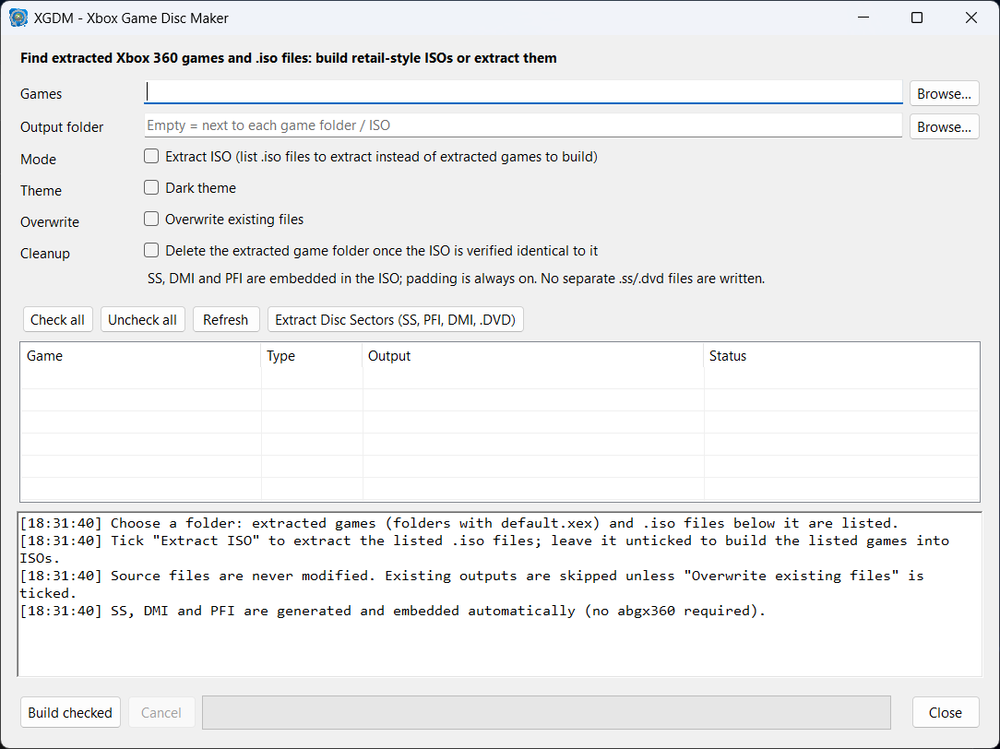

<p align="center">
  <br>
  <em>
   Xbox Game Disc Maker (XGDM) v0.2
  </em><br><br>
</p>
<p align="center">
<br>
</p>

XGD Maker turns extracted Xbox 360 game folders back into XGD2/XGD3 disc images (ISO), and turns ISOs back into folders. It writes the Xbox 360 file system (XDVDFS) itself, so the Xbox 360 XDK is not needed. When the game is in the [abgx360](http://abgx360.hadzz.com) database, the disc's verified security sector (SS) is added, so the image can be used with the [Xenon](https://github.com/xenon-emu/xenon) emulator.

## Requirements

| Dependency | Required | Used for |
|---|---|---|
| Windows 10 or 11, x64 | yes | running the program |
| [abgx360 1.0.7](http://abgx360.hadzz.com) | yes | checking every new ISO and running AutoFix; no ISO is built without it |
| Internet connection | for the SS | downloading the SS from the abgx360 database; files already in `%APPDATA%\abgx360\StealthFiles` are used offline |
| Free disk space | yes | about 7.6 GB per XGD2 ISO and 8.7 GB per XGD3 ISO |

The release `XGD Maker.exe` is a single self-contained file: the .NET runtime is included, so nothing else has to be installed. (Only building from source needs the .NET 8 SDK.)

To play the ISOs in Xenon you also need your own console's DVD key in Xenon's `dvdkey.txt` (one line, 32 hex characters, in `%APPDATA%\Xenon\console\` by default).

## Building ISOs

1. **Games folder:** choose a folder. Every folder inside it (at any depth) that directly contains `default.xex` is listed as a game. A game's own subfolders are not searched further.
2. **Output folder** (optional): where the ISOs are written. Leave it empty to write each ISO next to its game folder.
3. **ABGX360 (required):** path to `abgx360.exe`. Common install locations are filled in automatically. **Build checked** refuses to start without it.
4. Set the options (below), tick the games you want and click **Build checked**.

Games are built one at a time. **Cancel** stops the current game (its partial ISO is deleted) and skips the rest. A summary is shown at the end, and the full log is in the window and in each game's report file.

### List columns

| Column | Content |
|---|---|
| Game | ISO name: the folder name without suffixes such as `_extracted`, or `<parent> - <folder>` when two games share a folder name (e.g. `Disc1`) |
| Type | XGD2 or XGD3, detected from `default.xex`; games that cannot be detected are red and cannot be ticked |
| Output ISO | full path of the ISO that will be written |
| Status | progress and result (see below) |

### Options

| Option | Default | Effect |
|---|---|---|
| Padding | on | Fill unused space with random data, like retail discs. Writes the whole image, so it is slower; when off, unused space is zero. |
| ABGX patch | on | After each successful build, run abgx360 AutoFix in the background. Its output goes to the log, and its yes/no questions are answered "no" automatically. |
| SS | on | Look up the verified SS, embed it in the ISO and write `<game>.iso.ss`. |
| Existing ISOs | off | Replace an existing ISO and its `.iso.ss` / `.dvd`. When off, games whose ISO already exists are skipped. |
| Cleanup: `.dvd` | off | Delete the `.dvd` file after the build. |
| Cleanup: source folder | off | Permanently delete the game folder after the build (see Safety). Asks for confirmation before the batch starts. |

### Output files

| File | Content |
|---|---|
| `<game>.iso` | the disc image |
| `<game>.iso.ss` | the SS. **Keep it next to the ISO:** Xenon reads the SS from this file. |
| `<game>.dvd` | layer break file for burning (1913760 for XGD2, 2133520 for XGD3) |
| `<game>.builder-report.txt` | log of the build and of the abgx360 check |

### Status messages

| Status | Meaning |
|---|---|
| PASS – SS v2 embedded, ready for Xenon / PASS – SS v1 embedded, ready for Xenon | the ISO has a verified SS (version 1 or 2) and `.iso.ss` was written |
| PASS – no SS (no verified SS for this disc) | the game is not in the database; the ISO has no SS |
| Built, but ABGX360 check FAILED | abgx360 could not read the ISO; see the log |
| Skipped: ISO already exists | tick **Overwrite existing ISOs** to rebuild it |
| …, source deleted / source kept | result of the source folder cleanup |

## Extracting ISOs

- **Extract ISOs…:** pick one or more ISO files.
- **Extract all ISOs in folder…:** searches a folder and all its subfolders. The list appears at once, then each ISO's type (XGD2, XGD3, game partition, or not an Xbox 360 ISO) is checked in the background. Non-Xbox ISOs are unticked and greyed out. Tick the ones to extract and click **Extract checked**.

Each ISO is extracted to a folder with the ISO's name, next to the ISO (or in the Output folder). If that folder already exists and is not empty, `<name> (extracted)` is used instead, unless **Overwrite existing ISOs** is ticked. ISOs are opened read-only and never changed, and every file is copied byte for byte. Only the game files are extracted (the SS is not part of the file system), so building the extracted folder again gives the same set of files.

## How it works

### Disc type

A game is XGD3 when `default.xex` has a Disc Profile ID (optional header `0x00004304`), otherwise XGD2. This is the same rule abgx360 uses.

### Security sector (SS)

1. The program computes the CRC-32 of `default.xex` and reads `Xex_<CRC>.ini` from the abgx360 verified database, which lists the verified SS files for that game.
2. Each listed `SS_<CRC>.bin` is taken from `%APPDATA%\abgx360\StealthFiles`, or downloaded and saved there.
3. An SS is accepted only if its Media ID matches the Media ID in `default.xex`.
4. Both SS versions (v1 and v2) are used; when the database lists both for a disc, v2 is chosen.
5. The DMI and PFI listed for that SS are added as well.

If no SS is found, the ISO is written without one.

### Image layout

| | XGD2 | XGD3 |
|---|---|---|
| Game partition offset (with SS) | `0xFD90000` | `0x2080000` |
| SS / DMI / PFI | partition − `0x800` / − `0x1000` / − `0x1800` | partition − `0x8800` / − `0x9000` / − `0x9800` |
| Game partition size | 7,307,001,856 bytes | 8,662,351,872 bytes |

Without an SS, only the game partition is written (offset 0). The video partition is never written: its area is left empty.

The XDVDFS file system follows the retail layout:
- the volume descriptor is at sector 32;
- directory tables come first, then file data, each starting on a 2048-byte sector;
- directory tables are balanced binary search trees ordered by case-insensitive name;
- files have attribute `0x80`;
- on XGD2, sectors 48–4143 are left empty (on a real disc they hold authentication hashes).

### abgx360

- **Check (read-only):** `abgx360 -vws --af0 --noverify --noupdate -- "<iso>"`. A game passes when abgx360 finds `default.xex` and accepts the image size.
- **AutoFix:** `abgx360 -pc --af3 --rgn <region> --lang <n> --splitvid --patchitanyway -- "<iso>"`.
  - `--rgn` is the game's region code (`FFFFFFFF` for region-free games).
  - `--lang` is the Windows display language, with English as the fallback.
  - Afterwards the SS in the ISO is read again and copied to `<game>.iso.ss`.
- **Server addresses:** before each run, `%APPDATA%\abgx360\abgx360.ini` is checked. If its server addresses are missing or outdated, it is backed up as `abgx360.ini.bak` and rewritten for `abgx360.hadzz.com`.
- **Database files:** at startup, `abgx360.dat` and `GameNameLookup.csv` are downloaded if the server has newer copies. A warning is logged if the server does not answer.

## Safety

- Game folders are never modified.
- Existing ISOs are never replaced unless **Overwrite existing ISOs** is ticked.
- A partially written ISO is deleted when a build fails or is cancelled.
- **Source folder cleanup:** before deleting a game folder, the program reads the new ISO back and compares it with the folder: same folders, same files, same sizes, identical bytes, nothing extra on either side. The folder is deleted (permanently, not to the Recycle Bin) only if everything matches and the build succeeded. Otherwise it is kept and the reason is logged.
- Extraction rejects unsafe file names and entries that point outside the image.

## Limitations

- **Names and sizes:** file names must be plain ASCII (up to 255 characters), files can be at most 4 GB, and two names in one folder cannot differ only by case.
- **Not identical to the original disc:** file placement differs from Microsoft's tools, so the image is not byte-identical to a retail disc and its abgx360 "Game CRC" will not match the database.
- **AutoFix on XGD3:** abgx360 AutoFix cannot complete XGD3 images, because the database does not host their video partitions. The SS is still embedded by XGD Maker.
- **Games not in the database:** they get an ISO without SS, which Xenon cannot authenticate.

## Troubleshooting

| Problem | Solution |
|---|---|
| Xenon: "disc unreadable" | check that `<game>.iso.ss` is next to the ISO and that the status shows an embedded SS |
| "You must install .NET" when starting the program | use the single-file release build (see Building from source); a framework-dependent build only runs when its `.runtimeconfig.json` / `.deps.json` files are next to the exe and the **.NET 8 Desktop Runtime x64** (not just the .NET Runtime) is installed |
| "abgx360 required" | install abgx360 1.0.7 and set the ABGX360 field to `abgx360.exe` |
| Xenon: "Error opening DVD key file" | create `dvdkey.txt` with your console's DVD key |
| No SS for a game | the game's `default.xex` is not in the abgx360 database |
| Database server not answering | check the log at startup and `%APPDATA%\abgx360\abgx360.ini` |

## Building from source

Requirements: Visual Studio 2022 17.8 or later with the **.NET desktop development** workload, or the .NET 8 SDK.

Release build (single self-contained `XGD Maker.exe`, no .NET installation needed on the user's PC):

```powershell
dotnet publish XGDMaker -p:PublishProfile=SingleFile-win-x64
```

The exe is written to `XGDMaker\bin\publish\`. In Visual Studio: right-click the project → **Publish** → profile **SingleFile-win-x64**. Distribute only that exe, not the contents of `bin\Release`.

## Code provenance

All code is original. The XDVDFS format was implemented from public documentation and checked against the open-source xdvdfs and extract-xiso projects. Disc offsets, sizes and SS field positions are facts of the format, also used by abgx360. XGD Maker contains no Microsoft code, XDK tools, keys or game data. abgx360 is a separate program that XGD Maker runs; it is not included.

Intended for backups of games you own.

## License

[MIT](LICENSE)
